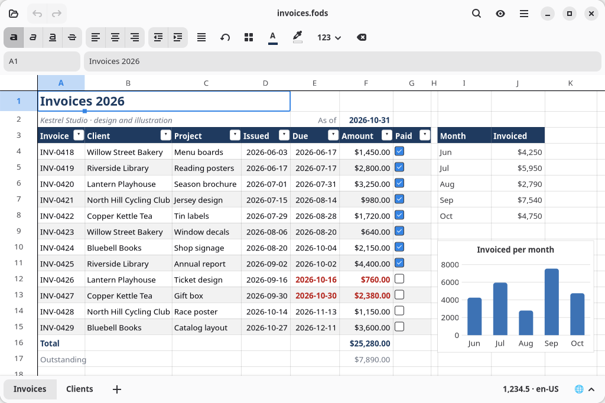
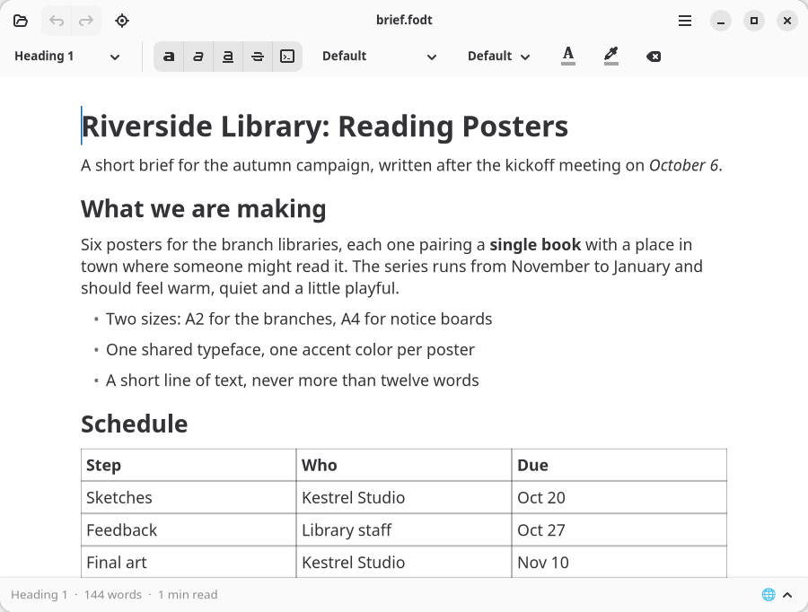

# grind

grind is an office suite written from scratch. It is 100% written using AI agents. Uses OpenDocument (odf) as its native format.





# Why this project exists?

I'm a software developer and a long-time Linux user. I love and appreciate the free and open source software ecosystem, and I've made an effort not to be trapped in non-free file formats for a long time.

But I've also gotten frustrated with the LibreOffice user experience. Don't get me wrong, the project has done so much for the free desktop, and it is great software that solves real problems. But the UX shows its age, and the community overall seems not to welcome change. I can never remember how to make Excel-like tables in Calc, and that is not my fault, this is a common operation that should be simple, but Calc makes it hard for some reason.

I know, many people will close this repo once they discover it is 'slop'. I don't want to argue if AI agents can possibly be used in ethical ways, but this human written readme should tell you something: This is a passion project. I would not have the time and energy to do this in any different way, an office suite is just way too complex for that.

# Project Status

No release exists yet. A spreadsheet and a word processor are included, the spreadsheet is more complete, both are serviceable for my own personal use.

# Approach

This project has clients for Linux, Windows, Mac, the Browser (using WebAssembly), a TUI and a CLI. It does purposefully not use any cross-platform toolkit, it exists as a proof of an idea: AI Agents enable a new way of building software, native for each platform. This was possible before but almost no one did it for economic reasons. Not enough benefit for the cost. With AI Agents, this calculation changes.

## Human and AI Authorship

This readme is fully human written. Source code, docs in the `docs` directory and all other content are AI authored.

# Novel Features

## 1. View source

In spreadsheets, it is often not obvious which cells contain data and which contain code (formulas). Authors may decide to use styles to signal this, but that is not more than a convention. Grind has a plain-text projection of its OpenDocument format which make it simple to review and audit spreadsheets.

Here is an example:

```
grind spreadsheet

// A spreadsheet written by hand — the starter `grind init --template sheet` writes.
//
// This file *is* the spreadsheet, in the form that lives in git: every cell is a line, so a
// change is a line of diff. Open it in grind's window, or turn it into a file LibreOffice opens.

// A name makes a formula say what it means. Names are the document's, so they sit outside
// every sheet.
name monthly "[$Costs.$B$2:.$B$4]"

sheet Costs {
    col 1 width="4cm"

    // `at` says where a grid of plain values starts; each `row` is one line of the sheet.
    at A1 {
        row Item       Monthly  Yearly
        row Rent       1450     #null
        row Utilities  180.5    #null
        row Internet   49.99    #null
    }

    // A `cell` is one cell that carries more than a value — here a formula, and no answer.
    cell C2 "=[.B2]*12"
    cell C3 "=[.B3]*12"
    cell C4 "=[.B4]*12"
    cell A5 Total
    cell B5 "=SUM(monthly)"
    cell C5 "=SUM([.C2:.C4])"

    style A1:C1 bold=#true background=silver
    style A5:C5 bold=#true
    format B2:C5 currency decimals=2 symbol="$"
}
```

## 2. Formulas in plain English

Grind can show spreadsheet formulas in a way that is more self documenting compared to other spreadsheet software.

So, instead of `=FV(Loan.B7/12;10*12;-Loan.B6)`

grind will show you this:

```
Future Value(
  Rate: Loan.B7/12,
  Number Of Periods: 10*12,
  Payment: -Loan.B6
)
```

## 3. A domain specific language to generate documents

Based on [rhai](https://rhai.rs/), an embedded scripting language you can generate spreadsheets based on dynamic data without the need for a Turing complete language. Grind does not have any macro support and never will, but many macro use-cases might be replaced with rhai scripts.

Example:

```
// A script is a sequence of statements, and **its value is the value of its last expression**.
// That value has to be a document, which is why the last line is a bare `s`: returning a sheet
// means a one-sheet spreadsheet.

let s = sheet("Sales");

// A header is a row that is bold. `push` takes a bare array or a `row(…)`; the second is what
// you want when the row needs an adjective.
s.push(row(["Region", "Q1", "Q2"]).bold());

s.push(["North", 4200, 4800]);
s.push(["South", 3100, 3300]);

// `sum_above()` is told nothing: it sums the contiguous run of numbers directly above wherever
// it lands, which is an AutoSum's rule and the only one that does not reach up into a header.
s.push(row(["Total", sum_above(), sum_above()]).bold());

s
```

## 4. A CLI that can do everything

The cli is a first class citizen, no matter if it is used by a human, in shell scripts or by AI Agents.

Discover what it can do using `grind --help`

## And more

Check out the (ai authored) [user guide for more features](doc/user-guide.md).

# License

The application is licensed under GNU Affero General Public License v3 or later. Full text in [LICENSES](./LICENSES).

Sample code is licensed under MIT.

Docs are licensed under CC-BY-4.0.

Each file carries a corresponding header.

# Trademarks

Product names and trademarks mentioned in this README belong to their respective owners. This project is not affiliated with or endorsed by them.
