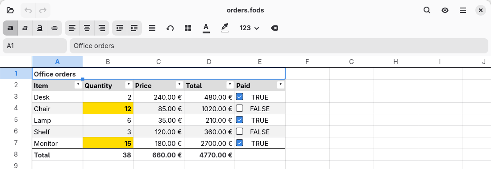
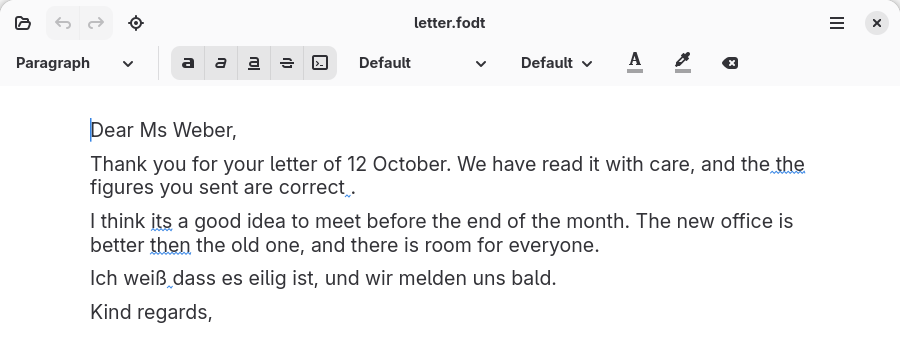

# grind User Guide

Draft of 16 October 2026. grind has no release yet. This guide describes the software as it is built today, and says so where a program lacks a feature or works differently.

# 1. About this guide

## 1.1 Who this guide is for

This guide is for people who write letters and reports, keep budgets and lists in spreadsheets, and want their files in an open format. You do not need to be a programmer. Chapters 1 to 7 cover everyday work in the windows, the terminal and the browser. Chapters 8 and 9 show how to repeat work from the command line and with scripts, and you can skip them until you need them.

## 1.2 What grind is

grind is an office suite with two kinds of document: **spreadsheets** and **text documents**. Both are saved in the OpenDocument Format (ODF), the international standard that LibreOffice, Collabora Office and many other programs read and write. A document you make in grind is not locked to grind.

The suite comes as several programs that share one engine. A formula, a spelling rule or a page layout means the same thing in all of them, and a document made in one opens in all the others.

| **Program** | **What it is** | **Runs on** |
| --- | --- | --- |
| grind-sheet-gtk | The spreadsheet window | Linux (GNOME) |
| grind-text-gtk | The word processor window | Linux (GNOME) |
| grind-tui | Both kinds of document, in a terminal | Linux, macOS, Windows |
| grind web | Both kinds of document, in a browser tab | Any current browser |
| grind for Windows | Both kinds of document, in one window | Windows |
| grind for Mac | Both kinds of document, in one window | macOS |
| grind | The command line, with every function | Linux, macOS, Windows |

Which program you use is a matter of taste. Most screenshots in this guide show the Linux windows and the browser.

## 1.3 What grind does differently

Four things set grind apart from other office suites.

**You can see what is data and what is a calculation.** A spreadsheet can mark every cell as an input, a formula or a label, and show the whole document as readable text. Section 3.12 explains how.

**Formulas can be read in plain English.** `=SUM(B2:B7)` can be shown as *Sum(Number: B2:B7)*, and a long formula can be explained step by step.

**Everything works from the command line.** Every function of every program is also a command, for people, for shell scripts and for other programs.

**Repetitive documents are built by scripts, not macros.** grind has no macros, and never will. Instead, a small script can build a document from data, such as a letter for each person on a list.

## 1.4 Conventions used in this guide

Keys are written like **Ctrl+S**. A **bold** word is something you see on the screen, such as a button or a menu entry. Text in `this typeface` is something you type. A line that begins with `$` is typed in a terminal, without the `$`.

The keyboard shortcuts are those of the Linux windows. The Windows and Mac programs follow the conventions of their own platform. On a Mac, the **Command** key takes the place of **Ctrl**.

# 2. Getting started

## 2.1 Starting a program

Start a program from your desktop's application menu, or from a terminal with the name of a file. Without a file name you start with an empty document.

```
$ grind-sheet-gtk budget.fods
$ grind-text-gtk letter.fodt
$ grind-tui report.fodt
```

The terminal program, `grind-tui`, reads the file to see whether it is a spreadsheet or a text document, so one command opens both. To start an empty text document in it, type `grind-tui --text`.

The Windows and Mac programs, and the browser version, open on a welcome screen with three choices: a new spreadsheet, a new text document, or a document you already have.

## 2.2 The spreadsheet window


The window has four parts:

- **The header bar** at the top, with the document name, undo and redo, and buttons for opening files, searching, viewing options and the main menu.
- **The format bar** below it, which changes how the selected cells look.
- **The formula bar**, which shows the address of the selected cell on the left and its content on the right.
- **The grid**, with the sheet tabs below it.

## 2.3 The word processor window


The word processor has a header bar like the spreadsheet's, a toolbar for block styles and character formatting, and the page you write on. The status bar at the bottom shows the kind of the current block, the number of words, the reading time and the spelling language. In the picture, the misspelt word *anual* has a red wavy line.

## 2.4 Opening documents

Press **Ctrl+O** to open a document. grind opens:

- OpenDocument spreadsheets and text documents (`.ods`, `.fods`, `.odt`, `.fodt`),
- the plain-text `.grind` form (section 9.4),
- Excel workbooks (`.xlsx`) and Word documents (`.docx`),
- CSV and TSV files, as spreadsheets,
- Markdown files (`.md`), as text documents.

grind decides what a file is by reading it, not by its name. An Excel workbook, a Word document, a CSV or a Markdown file is converted into a **new, unsaved document**. The original file is never changed, and a message tells you what, if anything, could not be carried over. grind reads these formats but does not write Excel or Word files.

**Recent documents.** The windows' open dialog lists the documents you used last under **Recent**; on Windows they are also added to the system's recent documents. The terminal's welcome pane lists the last nine, and the keys `1` to `9` open them. The browser keeps a copy of the last four documents you opened or saved, because a web page cannot reopen a file from your disk; they are on its welcome pane and in the command palette, and **Forget the recent documents** removes them.

## 2.5 Saving documents

Press **Ctrl+S** to save. A document without a name asks for one. In the word processor, **Ctrl+Shift+S** saves under a new name.

grind writes ODF in two forms:

- A **flat** file (`.fods`, `.fodt`) is one readable text file. grind offers it first, because it works well with version control and because you can open it in a text editor if you ever need to.
- A **package** (`.ods`, `.odt`) is a compressed archive, which is what most other programs save by default.

Both open in every program that reads ODF. Choose the form by the extension you give the file.

When you save a document that another program made, grind keeps everything it does not understand itself, and writes it back unchanged. Saving a document never makes it worse: if grind could not write something back faithfully, it refuses to save rather than lose it.

## 2.6 Undo and redo

**Ctrl+Z** undoes the last change and **Ctrl+Shift+Z** redoes it. In the word processor, **Ctrl+Y** also redoes. A change that touches many cells at once, such as a fill or a replace, is undone in one step.

# 3. Working with spreadsheets

## 3.1 Cells and addresses

The grid is made of numbered rows and lettered columns. The place where a row and a column meet is a **cell**, named by its column and row: the cell in column B, row 3 is **B3**. A rectangle of cells is a **range**, named by two corners: **B2:B7**. A cell on another sheet carries the sheet's name: **Prices.B2**.

## 3.2 Moving around and selecting

| **Keys** | **What they do** |
| --- | --- |
| Arrow keys | Move one cell |
| Ctrl+arrow | Jump to the edge of the data |
| Home, End | Go to the start or end of the row |
| Ctrl+Home, Ctrl+End | Go to the start or end of the sheet |
| Page Up, Page Down | Move a screenful |
| Shift with any of these | Extend the selection |
| Ctrl+A | Select the whole sheet |

You can also click a cell, drag across a range, or click a row number or a column letter to select the whole row or column. To go to a cell, type its address, or the name of a named range, in the name box at the left of the formula bar.

## 3.3 Entering data

Select a cell and type. **Enter** accepts the entry and moves down. **Tab** accepts it and moves right. **Shift** with either moves the other way. **Esc** cancels. To change what is already in a cell, press **F2** or double-click it.

grind decides what you typed by one rule:

- A leading `=` makes a formula.
- A number makes a number, read with the document's locale (section 3.10).
- `TRUE` and `FALSE` make logical values.
- Anything else is text.

To enter text that looks like a number or a formula, such as the part number `007`, start it with an apostrophe: `'007`.

## 3.4 Formulas

A formula starts with `=`. It can use numbers, cell references, ranges, the operators `+ - * / ^`, the comparison operators `= <> < > <= >=`, and functions:

```
=B2*1.19
=SUM(B2:B7)
=IF(C2>B2; "over budget"; "ok")
=VLOOKUP(A2; Prices.A2:B40; 2; FALSE())
```

Arguments are separated by a semicolon. When you press **Enter**, the cell shows the result and the formula bar keeps the formula.

**Help while typing.** When you start a function name, grind lists the functions that fit. Press **Tab** to accept one. A hint below the formula bar shows the function's arguments and which one you are typing. **Enter** always finishes the cell, even while the list is shown.

**Pointing at cells.** While you edit a formula, you can click a cell or use the arrow keys to put its address into the formula.

**Recalculation.** A formula recalculates when a cell it depends on changes. Press **F9** to recalculate the whole document.

## 3.5 Functions

grind implements the functions of the OpenFormula standard's core set, plus many common ones beyond it: 139 functions in all, among them `SUM`, `AVERAGE`, `COUNTIF`, `SUMIF`, `IF`, `VLOOKUP`, `ROUND`, `DATE`, `TODAY`, `PMT`, `TEXT` functions such as `LEFT` and `CONCATENATE`, and many more.

To browse them, choose **Functions…** from the main menu or the command palette. The list gives each function a plain-English name, a category and a short description. In a terminal, `grind sheet functions` prints the same list.

If a document uses a function that grind does not implement, the cell keeps the value it was saved with, and grind tells you which cells are affected.

## 3.6 Reading a formula in plain English

The formula bar can show a formula as a sentence. `=ROUND(A1; 2)` reads as *Round(Value: A1, Digits: 2)*, and `=SUM(B2:B7)` as *Sum(Number: B2:B7)*. This only changes how the formula is shown, never the formula itself. Turn it on and off with **Read Formulas as Sentences** in the View menu.

For a long, nested formula, choose **Explain This Formula**. It shows the formula taken apart, one function at a time, with the value of each part.

## 3.7 Filling, copying and clearing

To repeat a formula down a column, select the cell with the formula and the cells below it and press **Ctrl+D**. **Ctrl+R** fills to the right. You can also drag the small square at the corner of the selection, the **fill handle**. References in the formula move along: `=B2*2` filled down becomes `=B3*2`.

**Ctrl+C**, **Ctrl+X** and **Ctrl+V** copy, cut and paste. A copied range is placed on the clipboard as tab-separated text, so it pastes into any other spreadsheet or a text editor. **Delete** clears the selected cells.

## 3.8 Formatting cells

The format bar acts on the selected cells. From left to right it has bold, italic, underline and strikethrough; left, centre and right alignment; less and more indent; text wrapping; borders; text colour and fill colour; the number format; and **Clear**, which removes the formatting.

The number format decides how a number is shown. Choose from the list:

| **Format** | **Shows 1234.5 as** |
| --- | --- |
| General | 1234.5 |
| Number | 1,234.50 |
| Percent | 123450.00% |
| Currency | 1,234.50 € |
| Date, Time, Date and time | the number as a date or a time |
| Boolean | TRUE or FALSE |
| Text | the value as it was typed |

The separators depend on the document's locale (section 3.10). Formatting never changes the value itself: a cell showing 1,235 may hold 1234.5, and calculations use 1234.5.

**Column widths and row heights.** Drag the line between two column letters to change a column's width. Double-click it to fit the column to its widest entry. Rows work the same way. Rows grow by themselves to fit wrapped text.

**Zoom.** Hold **Ctrl** and turn the mouse wheel, or press **Ctrl++**, **Ctrl+-** and **Ctrl+0**.

## 3.9 Sheets

A document can have several sheets, shown as tabs at the bottom of the window. Click **+** to add a sheet. Right-click a tab to rename or delete it. When you rename a sheet, grind updates every formula, name and chart that refers to it, and one **Ctrl+Z** undoes the whole rename.

## 3.10 The document's locale

Every spreadsheet can state a **locale**, which decides how numbers are written and read. In a German document you type `1.234,50`; in an English one, `1,234.50`. Because the locale is stored in the document, everybody who opens it sees the same numbers. Set it in **Document Settings…** in the main menu, which also shows a sample of how a number will look.

## 3.11 Charts

To draw a chart, select the table, including its headings, and choose **Insert a Chart** from the command palette or the cell's context menu. The chart dialog shows a live preview. grind guesses which row or column holds the labels and whether the data runs down or across, and you can change the guess. Bar, line and pie charts are available.

A chart sits on the sheet. Click it to select it, drag it to move it, and drag one of its eight handles to resize it. **Shift** on a corner handle keeps the proportions. **Delete** removes the selected chart, the arrow keys nudge it, and **Esc** lets go.

To change a chart after it is made, right-click it and choose **Edit Chart…**. The dialog changes the kind (bar, line or pie), the title, the legend, the cells it reads from, and the axes' titles, labels and gridlines, with a preview as you go. Colours of a series or of a single bar or slice are set with `grind sheet chart-style`. In the browser the palette offers **Change the chart…**, and the Windows and Mac programs have a Chart menu that does the same in words.

## 3.12 Seeing what a spreadsheet is made of

A table of numbers does not show which numbers somebody typed and which a formula calculated. grind can show it.


Turn on **Show What Each Cell Is** in the View menu. Every cell gets a small mark:

| **Mark** | **Meaning** |
| --- | --- |
| Filled diamond, blue | An input with a name, used by formulas |
| Hollow diamond | An input, such as a number in a table |
| ! | A number that a formula uses by its address, without a name. Consider naming it |
| = | A calculation on the same sheet |
| Arrow | A calculation that reads another sheet |
| T | A label |
| Cross | A formula that gives an error |
| \~ | A formula whose saved value is out of date |

**Show Where Names Live** outlines every named range. **Show Formulas** shows formulas instead of their results. **Show the Source** (**Ctrl+Shift+U**) shows the whole document as plain text, one line per cell, and selecting a line selects its cell. None of these views changes the document.

## 3.13 Finding and replacing

Press **Ctrl+F** to search. grind searches what the cells show, and moves to each match in turn. The replace field changes text and formulas in every matching cell, as one change that **Ctrl+Z** undoes.

## 3.14 Checking a spreadsheet

Press **F8** for **Check the Document**. grind lists problems such as a formula that gives an error, a reference to an empty cell, a saved value that is out of date, or a misspelt word. Click an entry to go to the cell.

## 3.15 CSV files

Opening a CSV or TSV file makes a new spreadsheet from it. To read a CSV file into the spreadsheet you have, use **Import CSV**; to write a range out, use **Export CSV**. grind finds the delimiter from the file's content. Fields that look like numbers become numbers, and a field such as `007` stays text.

## 3.16 Merging, hiding and turning cells

**Merging.** Select a range, right-click it and choose **Merge Cells**: its top-left cell is drawn across the whole range, for a title over a table. What the other cells held is kept out of sight and comes back with **Unmerge Cells**.

**Hiding rows and columns.** Right-click a row number or a column letter and choose **Hide Row** or **Hide Column**; with several selected, **Hide Rows** or **Hide Columns**. A small marker shows where they are; click it to show them again. Calculations still use hidden cells.

**Row heights.** A row grows by itself to hold wrapped or turned text. **Fit Row Height** in the command palette gives rows back to their content after you changed them by hand.

**Turning text.** The **Text Rotation** button on the format bar turns the text of the selected cells: angled up or down, rotated to read upwards or downwards, or back to **No Rotation**. It is useful for narrow column headings.

## 3.17 Checkboxes

A cell can hold a **checkbox** that shows whether another cell is TRUE or FALSE. Click it, or select its cell and press **Space**, to tick or untick it; the linked cell changes with it, so formulas can count what is ticked. Every program draws and ticks checkboxes. To add one, use the command line:

```
$ grind sheet checkbox orders.fods E3 --link F3
```

## 3.18 Filters and tables

**Filtering rows.** Select a table, including its headings, and choose **Filter Rows** from its context menu. Each heading gets a small button; click one and choose which values to show. Rows that do not match are hidden, not deleted, and calculations still use them. Choose **Filter Rows** again to remove the filter.

**Formatting as a table.** **Format as Table…** in the context menu does several things in one step: it adds the filter buttons, shades every other row, can add a **totals** row under the table with a sum, average, count, minimum or maximum for each column, and gives the range a name such as `Table1`, which formulas can use. Everything it adds is ordinary formatting, so you can change any part of it afterwards. One **Ctrl+Z** undoes all of it.



## 3.19 Conditional formatting

A **rule** draws cells differently while a formula is true: for example, every quantity over 10 in yellow, or a whole row in green once it is paid. Select the cells, right-click and choose **Conditional Formatting…**. Write the condition for the top-left cell, such as `=B3>10`, and pick how the cells should look; grind moves the condition to every other cell the way filling moves a formula. A cell can have several rules, and the first one that holds is the one you see. The same dialog lists the sheet's rules and removes them.

In the terminal the commands are `:rule yellow =B3>10`, `:rules` and `:rule!`; in the browser the palette lists them under **Rules**.

# 4. Working with text documents

## 4.1 Blocks

A text document is a sequence of **blocks**. A block is a paragraph, a heading or a list item. **Enter** ends a block and starts a new one, and **Backspace** at the start of a block joins it to the one before.

Choose a block's kind from the box at the left of the toolbar, or with the keyboard:

| **Keys** | **Block kind** |
| --- | --- |
| Ctrl+0 | Paragraph |
| Ctrl+1, Ctrl+2, Ctrl+3 | Heading 1, 2, 3 |
| Ctrl+L | List item |

The box also offers Title, Subtitle and Headings 4 to 6. Press **Tab** at the start of a list item to indent it one level, and **Shift+Tab** to bring it back.

Headings make up the document's outline. **Ctrl+Shift+O** opens it, and choosing a heading takes you there.

## 4.2 Formatting text

Select text and use the toolbar or the keys:

| **Keys** | **Format** |
| --- | --- |
| Ctrl+B | Bold |
| Ctrl+I | Italic |
| Ctrl+U | Underline |

The toolbar also has strikethrough, code, the font and the size, the text colour and the highlight colour, and **Clear**, which removes direct formatting. A button that looks pressed tells you the selection already has that format.

**Formatting as you type.** You can type formatting the way many people do in plain text. When you type `**bold**`, the asterisks disappear and the word is bold. The same works for:

| **You type** | **You get** |
| --- | --- |
| `**word**` | **bold** |
| `*word*` | *italic* |
| `__word__` | underline |
| `~~word~~` | strikethrough |
| `` `word` `` | code |
| `#`  at the start of a line | a heading |
| `-`  at the start of a line | a list item |

One **Ctrl+Z** takes back the whole formatted word.

## 4.3 Tables and pictures

**Ctrl+Shift+T** inserts a table. Click a cell to type in it; a cell can hold several paragraphs.

**Ctrl+Shift+I** inserts a picture from a file. Give each picture **alternative text** with **Ctrl+Alt+A**. Screen readers speak it, and it stands in for the picture where the picture cannot be shown.

## 4.4 Going to a place

**Ctrl+G** goes to an address. **Ctrl+F** searches. A place in a document can be named three ways:

| **Address** | **Means** |
| --- | --- |
| `p12` | The twelfth block |
| `#intro` | The block with the bookmark *intro* |
| `§2.1` | The first subsection of section 2 |

A bookmark or a section address keeps pointing at the same place when you edit above it. A block number does not.

## 4.5 Pages, print preview and PDF

While you write, a document is one continuous column. grind lays it out on pages when you print or export it.


| **Keys** | **Command** |
| --- | --- |
| Ctrl+Shift+P | Print preview |
| Ctrl+Shift+E | Export as PDF |
| Ctrl+P | Print |

The pages are those the document states: the paper size, the margins, and the header and footer with their page numbers. A document that states no page is printed on A4. grind prints only on the international ISO paper sizes, such as A4 and A5.

The same document always produces the same PDF. The PDF has an outline of the headings, and it is tagged, so screen readers can read it.

## 4.6 Headers, footers and letterheads

A document's header and footer are printed on every page. A page number or a page count in one shows the right number on each page.

A document can use different pages for different parts. A letter template, for example, can put a full letterhead on the first page and a short header on the pages after it, and draw fold marks at the edge of the paper. grind prints all of these as the template describes them. Section 9.2 shows how to fill such a template automatically.

## 4.7 Markdown

Markdown is a plain-text notation for headings, lists and emphasis. A `.md` file opens as a new, unsaved document. **Import Markdown** inserts a Markdown file into the document you have, and **Export Markdown** (**Ctrl+Alt+S**) saves the document, or the selection, as a Markdown file. Pictures are written as files in a folder next to it.

## 4.8 Word documents

A Word document (`.docx`) opens as a new, unsaved text document. Headings, lists, tables, pictures, headers, footers and the page come across. A message names anything that does not. Save the result as an ODF document.

## 4.9 Moving and deleting paragraphs

Right-click a paragraph and choose **Move Paragraph Up** or **Move Paragraph Down** to swap it with its neighbour, or **Delete Paragraph** to remove it. With several paragraphs selected, they move or go together. Each is one step for **Ctrl+Z**. A heading moved this way leaves its section behind; to move a whole section, use `grind text move` (section 8.3).

# 5. Spelling and grammar

grind checks spelling as you type, in text documents and in the text of spreadsheet cells. A word grind does not know gets a red wavy line. The word you are still typing is left alone until you finish it.

## 5.1 Languages

grind checks English (US), German, French, Spanish, Italian, Portuguese (Portugal) and Polish.

Unless you choose otherwise, spelling is checked in **All languages**: a word is right if any of the seven dictionaries knows it, so a French name in an English letter is not marked. Suggestions come from the document's main language: the one the document states, or else the one most of its words are in.

To check in one language alone, or to turn spelling off, use the **language picker** at the right-hand end of the status bar. It shows a globe for all languages, the flag of the language's country for one, or **Off**; click it to choose. On Windows and in the terminal it shows letters instead, `ALL` or `DE`. The same choice is in the menus:

- In the spreadsheet window, the View menu (the eye button) has **Spelling Language**, next to **Check Spelling**, which turns spelling on and off (**Shift+F7**).
- In the word processor window, it is the **Spelling** submenu of the main menu.
- In the browser, the command palette lists **Spelling: all languages**, **Spelling: off** and one entry for each language.
- In the terminal, type `:spell de`, `:spell auto` (all languages) or `:spell off`.

Your choice is remembered, separately for spreadsheets and for text documents, and it holds for every document you open until you change it. It is your setting, and it is never written into a document. If you turn spelling off, it stays off.

## 5.2 Correcting a word

Right-click a misspelt word. The menu lists suggestions; choose one to replace the word. **Ignore All** accepts the word until you close the program. **Add to Dictionary** keeps it in your own word list for good.


In the browser, put the cursor in the word and press **Ctrl+K**: the palette lists the suggestions, **Ignore** and **Add to your dictionary**, and **Go to the next misspelling**. The browser fetches a language's dictionary the first time it needs it, so the first check in a language takes a moment.

In a spreadsheet only typed text is checked: never a number, a date or the result of a formula.

## 5.3 Your personal dictionary

Words you keep with **Add to Dictionary** go into your **personal dictionary**. It holds for every document and every language, and it is never written into a document. To see it, remove a word or add one by hand, open **Personal Dictionary…**: in the word processor it is in the **Spelling** submenu, in the spreadsheet window in the View menu and under the language picker. In the browser the palette has **Spelling: your dictionary…** and **Spelling: add a word to your dictionary…**. In the terminal, `:dict` lists the words, and `:dict add word` and `:dict rm word` change the list. From the command line:

```
$ grind words
$ grind words --add Hunspell
$ grind words --remove Hunspell
```

The windows, the terminal and the command line share one list, kept in a file of yours (`~/.config/grind/words`). The browser keeps its own.

## 5.4 Grammar

grind also checks grammar in text documents. A built-in checker looks for common mistakes in English and German: a word written twice, *its* where *it's* is meant, *then* for *than*, *a* before a vowel sound, a missing comma before *dass* or *weil*, a space before a full stop, and more. Each paragraph is checked in the language its own words are in. The checker is on unless you turn it off, and nothing leaves your computer.

A finding gets a blue wavy line, and a suggestion about style a dotted one (the Mac marks them with green dots). Right-click it: the menu starts with what is wrong and what it could be instead, and choosing one replaces the text. **Ignore Rule** stops that kind of finding from being reported, in every document, until you report it again (section 10).



**Style suggestions** point out wordiness rather than mistakes: *in order to* where *to* will do, *at this point in time*, too many *very*s, a sentence of more than 40 words. They are off unless you turn them on.

- In the word processor window, the main menu has a **Grammar** submenu with **Check Grammar**, which turns grammar on and off, and **Style Suggestions**.
- On Windows, the View menu has **Check Grammar** and **Grammar Style Suggestions**, and **Ctrl+F7** goes to the next finding.
- On the Mac, the Spelling menu has **Check Grammar With Spelling**, **Grammar Style Suggestions** and **Next Grammar Finding** (**Option+Cmd+;**).
- In the browser, the palette has **Grammar: check**, **Grammar: off** and **Grammar: style suggestions too**. With the cursor in a finding, **Ctrl+K** lists its replacements and **Ignore this rule**.
- In the terminal, `}` and `{` go to the next and previous finding and show what is wrong on the status line; `:fix 1` takes the first replacement. `:grammar off`, `:grammar on` and `:grammar style on` are the switches.

Your choices are remembered for every document.

## 5.5 LanguageTool

The built-in checker is small on purpose. For a much fuller check, in many more languages, grind can ask **LanguageTool**, a free grammar checker that runs as a server. You can run it on your own computer, use LanguageTool's public server, or use a LanguageTool Premium account. Until you set one up, grind does not ask it.

**On your own computer.** With Podman or Docker installed, start a server:

```
$ podman run -d --rm --name grind-lt -p 8010:8010 docker.io/erikvl87/languagetool
```

The image is made by the community, not by LanguageTool; any LanguageTool server will do. Then tell grind where it is, and check that it answers:

```
$ grind grammar http://localhost:8010 --with-builtin
$ grind grammar --check-server
```

`--with-builtin` keeps the built-in checker on as well. Its findings appear at once and LanguageTool's a moment later; where both mark the same words, LanguageTool's is the one shown. Your text stays on your computer.

**LanguageTool's public server.** `grind grammar public` needs no setup, but your text is sent to LanguageTool over the internet, and the server takes only a limited amount of text a minute. On the command line, a whole document is sent there only with `--public-ok`.

**LanguageTool Premium.** Put your account's user name and API key in the environment, then choose it:

```
$ export GRIND_LANGUAGETOOL_USER=you@example.com
$ export GRIND_LANGUAGETOOL_KEY=your-api-key
$ grind grammar premium
```

grind never writes the key to a file.

`grind grammar builtin` goes back to the built-in checker, and `grind grammar off` turns grammar off altogether. `grind grammar` on its own prints what is set. The setting is yours, kept in `~/.config/grind/grammar`, and the windows and the terminal follow it. They ask LanguageTool shortly after you stop typing, only about the paragraphs that changed, and say where your text goes. If the server does not answer, grind says so once and tries again later. In the terminal, `:grammar http://localhost:8010` or `:grammar public` sets it as well.

**From a window.** The word processor's **Grammar** submenu, the View menu on Windows and the Spelling menu on the Mac have **LanguageTool Server…**. Type the address (`localhost:8010` is enough), `public` or `premium`, and the window uses it at once; the word processor also says whether the server answers. `off` turns LanguageTool off again, and in the word processor an empty field does too. It is the same setting `grind grammar` writes.

The browser has a setting of its own: the palette's **Grammar: LanguageTool server…** asks for an address or `public`, and **Grammar: LanguageTool off** stops asking. A server on your computer must allow the page to ask it (LanguageTool's `--allow-origin` option), which the container above does. Premium is not offered in the browser, because the page keeps no keys.

# 6. Using grind in a terminal

`grind-tui` runs in any terminal. It works like the editor vi: the keyboard is in one of a few **modes**.

| **Mode** | **For** | **Enter it with** |
| --- | --- | --- |
| Normal | Moving around | **Esc** |
| Insert | Typing | `i` |
| Visual | Selecting | `v` |
| Command | Commands | `:` |

The title bar at the top shows the document and its sheets or headings. The status bar at the bottom shows the mode, your position and whether there are unsaved changes.

## 6.1 Normal and Visual mode

| **Key** | **What it does** |
| --- | --- |
| `h` `j` `k` `l` or the arrows | Move |
| `i` | Start typing |
| `v` | Start selecting |
| `y` | Copy the selection |
| `p` | Paste |
| `d` or `x` | Delete |
| `u` | Undo |
| `n`, `N` | Next and previous search match |
| `]`, `[` | Next and previous misspelt word |
| `*` `/` `_` `~` (Visual mode) | Bold, italic, underline, strikethrough |

## 6.2 Commands

Type `:` and a command, then **Enter**.

| **Command** | **What it does** |
| --- | --- |
| `:w` | Save |
| `:q` | Quit; `:q!` quits without saving |
| `:wq` | Save and quit |
| `:help` | Show help |
| `:find word` | Search |
| `:s/old/new/` | Replace (spreadsheet) |
| `:recalc` | Recalculate (spreadsheet) |
| `:roles` | Mark what each cell is (spreadsheet) |
| `:outline` | List the headings (text) |
| `:table` | Insert a table (text) |
| `:mark name` | Set a bookmark (text) |
| `:pdf` | Export as PDF (text) |
| `:spell` | Show the spelling language; `:spell de` chooses one |
| `:fix 1` | Replace a misspelt word with the first suggestion |
| `:lint` | Check the document |
| `:source` | Show the document as plain text |

## 6.3 More commands

| **Command or key** | **What it does** |
| --- | --- |
| `}`, `{` | Next and previous grammar finding (text) |
| `:grammar off` | Grammar off; `:grammar on`, `:grammar style on`, and `:grammar ignore` for the rule at the cursor (text) |
| `:grammar http://localhost:8010` | Ask LanguageTool as well (section 5.5) |
| `:dict` | Your personal dictionary; `:dict add word`, `:dict rm word` |
| `:move p12` | Move this block before p12 (text) |
| `:print` | Print the document, through the system's `lp` (text) |
| `:merge`, `:unmerge` | Merge the selected cells, or undo the merge |
| `:hide`, `:show` | Hide or show the selected columns; `:hide rows` and `:show rows` for rows |
| `:rotate up` | Turn the text: `45`, `up`, `down` or `none` |
| `:filter` | Filter buttons over the table; again to remove them |
| `:format-table --totals` | Format the table, with a totals row |
| `:rule yellow =B3>10` | A conditional format; `:rules` lists them, `:rule!` removes them |
| Space | Tick or untick a checkbox |
| `:welcome` | Back to the welcome pane |

`y` copies to the system clipboard as well, in terminals that allow it, so you can paste into other programs. `:help` lists every command.

# 7. Using grind in the browser


The browser version is a web page with no menus. It has one bar with **Open…**, **Save**, undo and redo, and **Commands**, which opens the command palette. A second bar holds the formatting tools for the kind of document that is open. A spreadsheet adds the formula bar and the sheet tabs.

## 7.1 The command palette

Press **Ctrl+K**, or click **Commands**, type a few letters of what you want, and press **Enter**. The palette holds every command that has no button. It is also the way to go somewhere: type an address such as `B12` or `p12`, the name of a sheet, a named range, a heading or a bookmark.

## 7.2 Opening and saving

Click **Open…**, or drop a file anywhere on the page. **Save** downloads a copy to your downloads folder. It cannot write over the file you opened, because a web page has no access to your files.

Your documents never leave your computer: the page reads and writes them itself. Your spelling choices and your own word list are kept by the browser for this page only, and clearing the page's data clears them.

## 7.3 Shortcuts and recent documents

**F1** lists the page's keyboard shortcuts. What the windows do from menus is in the palette: for example **Merge cells**, **Hide row(s)**, **Rotate text up**, **Filter rows**, **Format as table**, **Format as table with totals…**, **Conditional format for the selection…**, **Change the chart…** and the **Grammar** commands (section 5.4).

The page keeps a copy of the last four documents you opened or saved, up to about 750 KB each, in the browser's storage. The welcome pane lists them, and in the palette they are **Open** and the document's name. **Forget the recent documents** removes them.

# 8. The command line

Every function of grind is also a command. This is useful for repeating a job, for working on a server, and for checking a file without opening it.

## 8.1 The shape of a command

```
$ grind <area> <verb> <file> [arguments]
```

The area is `sheet` for spreadsheets and `text` for text documents. A few verbs work on any document and find out what it is by reading it: `info`, `lint`, `convert` and `project`.

Each command reads the file, does one thing and writes the file back. Two options work with every command: `--dry-run` shows what a command would do without writing anything, and `--format json` gives the answer in a form other programs can read. Add `--help` to any command for a full description.

## 8.2 A spreadsheet from the command line

This example makes a small spreadsheet, adds a formula and shows the result:

```
$ grind sheet new book.ods
$ grind sheet set book.ods A1 1
$ grind sheet set book.ods A2 '=[.A1]*2'
$ grind sheet recalc book.ods
$ grind sheet view book.ods A1:A2
```

On the command line, formulas are written in ODF's own form, as they are stored in the file: `[.A1]` is the cell A1. The `eval` command tries out a formula without storing it. Give it the cell the formula would sit in, because relative references depend on that; `--trace` shows the value of every part:

```
$ grind sheet eval book.ods A3 '=SUM([.A1:.A2])'
$ grind sheet eval book.ods A3 '=SUM([.A1:.A2])' --trace
```

Other useful commands:

```
$ grind sheet import-csv book.ods data.csv
$ grind sheet export-csv book.ods --delimiter tab
$ grind sheet format book.ods B2:B9 currency
$ grind sheet locale book.ods de-DE
$ grind sheet functions
```

## 8.3 A text document from the command line

```
$ grind text new letter.fodt
$ grind text import-md letter.fodt notes.md
$ grind text view letter.fodt
$ grind text export-md letter.fodt
$ grind text export-pdf letter.fodt letter.pdf --paper a4
$ grind text preview letter.fodt page1.png --page 1
```

A block is addressed as in the window: `p12`, `#intro` or `§2.1`.

## 8.4 Any document

```
$ grind info report.fodt
$ grind lint report.fodt
$ grind convert book.fods book.ods
$ grind convert book.fods book.grind
$ grind sheet import workbook.xlsx workbook.fods
$ grind text import letter.docx letter.fodt
```

`grind info` tells you what a document is and what is in it. `grind lint` checks it and ends with an error when it finds one, so you can use it in a script. `grind convert` changes between the package, the flat file and the `.grind` form. The two `import` commands convert an Excel workbook or a Word document into ODF.

## 8.5 Spelling from the command line

```
$ grind text spell report.fodt --suggest
$ grind text spelling de
$ grind sheet spelling off
```

The first command lists the misspelt words in a document, with suggestions. `grind text spelling` and `grind sheet spelling` set the remembered language for each kind of document, the same setting the windows use. Without a value they print the current one.

## 8.6 Grammar from the command line

```
$ grind text grammar letter.fodt
p2+75   builtin:repeated-word   grammar   the   “the” twice
p3+8    builtin:its-it's        grammar   its   “it's”: it is   it's
$ grind text correct letter.fodt p3+8 its "it's"
$ grind text grammar letter.fodt --picky
$ grind text grammar letter.fodt --languagetool http://localhost:8010
```

Each line is where a finding starts, its rule, its kind, the text it covers, what is wrong and what it could be instead. `grind text correct` makes one change, and refuses if the text there is no longer what you named. `--picky` adds style suggestions. `--languagetool` asks a server this once, whatever is set; `--builtin` uses the built-in checker alone. `grind lint` reports the built-in checker's findings too, so a script can stop on them. Section 5.5 shows how `grind grammar` sets the checker, and `grind grammar --ignore` with a rule's name stops reporting it.

## 8.7 More commands

Every command has `--help`. Beyond those above, these are worth knowing:

| **Command** | **What it does** |
| --- | --- |
| `grind sheet clear` | Empty a cell or a range |
| `grind sheet height`, `grind sheet fit` | Set row heights, or fit rows and columns to their content |
| `grind sheet hide` | Hide or, with `--unhide`, show columns or rows |
| `grind sheet merge` | Merge a range, or with `--unmerge` undo it |
| `grind sheet checkbox` | Add a checkbox, tick it, or take it away |
| `grind sheet filter` | Filter rows by their values |
| `grind sheet format-table` | Format a range as a table, with an optional totals row |
| `grind sheet rule` | Add, list or remove conditional formats |
| `grind sheet remove` | Delete a sheet |
| `grind sheet fmt` | Print a formula in its tidy form |
| `grind sheet correct`, `grind text correct` | Replace one misspelt word |
| `grind sheet chart-add`, `chart-edit`, `chart-list`, `chart-remove`, `chart-reshape`, `chart-style` | Add, change, list, remove, move and colour charts |
| `grind text insert`, `grind text delete`, `grind text move` | Add, delete and move blocks |
| `grind text split`, `grind text join` | Split a block in two, or join it with the next |
| `grind text erase` | Erase characters, keeping the blocks |
| `grind text image`, `grind text alt` | Insert a picture, and give it alternative text |
| `grind text caret` | Move a caret by lines and print where it lands |
| `grind text words` | Count words and characters |
| `grind words` | Your personal dictionary |
| `grind project` | Print any document in its plain-text form |
| `grind licences` | The third-party components grind is built from, and their licences |

# 9. Automating work

## 9.1 Scripts that build documents

A script is a small text file that describes a document. It is written in a simple language called Rhai. A script cannot read your files, use the network or start programs. It can read one data file in JSON format from its own folder. Because of these limits, the same script and data always produce exactly the same document.

```
$ grind build budget.rhai -o budget.fods
$ grind test budget.rhai
```

`grind build` builds the document. `grind test` runs the checks written into the script, such as "the total is the sum of the rows", and reports any that fail.

Scripts suit documents you make again and again from changing data: a monthly report, a loan schedule, a grade book, or a letter to each person on a list. The `examples` folder has a working script for each of these.

## 9.2 A letter to each person on a list

A script can return several documents at once. grind then writes them into a folder, one file each. The letter examples write one business letter per recipient, laid out on a DIN 5008 template, as PDF files:

```
$ grind build examples/letters/nebenkosten.rhai -o letters --as pdf
```

The template is an ordinary text document with the page, the letterhead and the paragraph styles. The script fills in the recipient, the date and the figures, and calculates the figures itself. You design the template in any word processor and save it as a flat text document (`.fodt`).

## 9.3 Checking documents automatically

`grind lint` looks for the mistakes people make in spreadsheets and documents: a formula that gives an error, a saved value that is out of date, a style that does not exist, a misspelt word. It never changes the document, and it ends with an error when it finds one, so it can check documents automatically.

## 9.4 The plain-text form

The `.grind` form writes a document as readable text. A spreadsheet becomes a list of sheets, rows and cells:

```
$ grind sheet project book.ods
```

You can edit the `.grind` file in any text editor and open it again in grind. A change to one cell changes one line of the file, which makes the form useful for reviewing a spreadsheet somebody else made and for keeping documents in a version-control system such as Git.

## 9.5 Writing scripts in an editor

`grind init` sets up a directory for writing scripts and plain-text documents in an editor: a starter script with its data and tests, and settings, snippets and recommended extensions for VS Code. In a git repository it also lets `git diff` show the cells that changed in a spreadsheet. It never overwrites a file you changed.

`grind lsp` is a language server: point your editor's language client at it, and it shows problems on the right line, a formula's result beside it, and completion for functions and names. `grind definitions` prints what an editor needs to complete a script's functions.

# 10. Troubleshooting

**A file does not open.** Check what the file is with `grind info` followed by the file name. Password-protected files cannot be opened. A flat file is plain text, so a damaged one can be read in a text editor.

**A cell shows an error such as** **`#DIV/0!`** **or** **`#NAME?`****.** Select the cell and read its formula, or let grind explain it (section 3.6). **Check the Document** (**F8**) lists every cell with an error.

**A cell shows** **`###`****.** The column is too narrow for the number. Widen it, or double-click the line at the right of the column letter.

**Numbers look wrong.** Check the document's locale (section 3.10). `1.234` is one thousand two hundred thirty-four in German and one and a bit in English.

**Spelling underlines almost every word.** The document is being checked in one language that is not its own. Choose the right one, or **All languages** (section 5.1).

**Grammar marks something that is right.** Right-click it and choose **Ignore Rule**. To have the rule reported again, run `grind grammar` to see the rules you ignored, and `grind grammar --unignore` with the rule's name. Style suggestions can be turned off on their own (section 5.4).

**LanguageTool finds nothing.** Run `grind grammar --check-server`: it says whether the server answers, and which version it is. Check that the container is running (`podman ps`). In the browser, the server must be started with `--allow-origin`.

**A document looks different in another program.** Programs can draw the same ODF slightly differently, and a font that is not installed is replaced. To share exactly how a page looks, export a PDF.

**A command fails.** Add `--help` to the command to see what it expects. `grind --help` lists all commands.

# Appendix A: Keyboard shortcuts

These are the shortcuts of the Linux windows. In the word processor, **Ctrl+?** shows the full list. In the spreadsheet window, anything without a shortcut is in the command palette (**Ctrl+K**); in the word processor, it is in the main menu.

| **Keys** | **Spreadsheet** | **Text document** |
| --- | --- | --- |
| Ctrl+N | New document | New document |
| Ctrl+O | Open | Open |
| Ctrl+S | Save | Save |
| Ctrl+Shift+S |  | Save as |
| Ctrl+Z | Undo | Undo |
| Ctrl+Shift+Z | Redo | Redo |
| Ctrl+F | Find | Find |
| Ctrl+G |  | Go to an address |
| Ctrl+K | Command palette | Insert a link |
| Ctrl+L |  | List item |
| Ctrl+C, Ctrl+X, Ctrl+V | Copy, cut, paste | Copy, cut, paste |
| Ctrl+D, Ctrl+R | Fill down, fill right |  |
| Ctrl+B, Ctrl+I, Ctrl+U | Bold, italic, underline | Bold, italic, underline |
| Ctrl+0 | Reset zoom | Paragraph |
| Ctrl+1 to Ctrl+3 |  | Headings 1 to 3 |
| Ctrl+Shift+T |  | Insert a table |
| Ctrl+Shift+I |  | Insert a picture |
| Ctrl+Shift+O |  | Outline |
| Ctrl+Shift+U | Show the source | Show the source |
| Ctrl+Alt+S |  | Save as Markdown |
| Ctrl+Shift+E |  | Export as PDF |
| Ctrl+Shift+P |  | Print preview |
| Ctrl+P |  | Print |
| F2 | Edit the cell |  |
| F8 | Check the document | Check the document |
| F9 | Recalculate |  |
| Shift+F7 | Spelling on and off |  |
| Ctrl+? |  | List of shortcuts |

**In the other programs.** In the browser, **F1** lists the shortcuts. In the terminal, `]` and `[` go to the next and previous misspelt word, `}` and `{` to the next and previous grammar finding. On Windows, **F7** goes to the next misspelt word and **Ctrl+F7** to the next grammar finding; on the Mac, **Option+Cmd+;** goes to the next grammar finding.

# Appendix B: Glossary

**Block.** A paragraph, heading or list item in a text document.

**Bookmark.** A name for a place in a text document, which keeps pointing at the same place when you edit above it.

**Cell.** One box of a spreadsheet, named by its column and row, such as B3.

**Command palette.** The searchable list of every command, opened with Ctrl+K.

**Flat file.** An ODF document saved as one plain text file: `.fods` or `.fodt`.

**Formula.** A cell entry that starts with `=` and calculates a value.

**Lint.** An automatic check of a document for mistakes.

**Locale.** The conventions a document follows for writing numbers, such as which character is the decimal point.

**ODF.** The OpenDocument Format, the open standard grind uses for its files.

**Package.** An ODF document saved as a compressed archive: `.ods` or `.odt`.

**Range.** A rectangle of cells, named by two corners, such as B2:B7.

**Template.** A document that provides the page, the letterhead and the styles for other documents.
